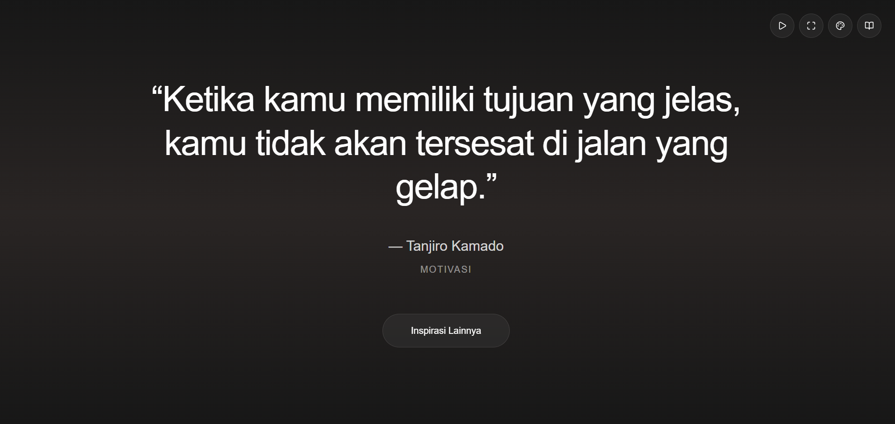
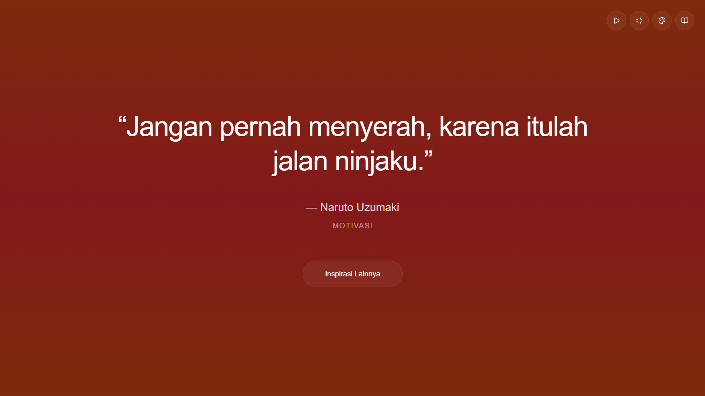

# Quotes API 🌟

[](https://nextjs.org/)
[](https://www.typescriptlang.org/)
[](https://tailwindcss.com/)
[](https://www.framer.com/motion/)
[](https://opensource.org/licenses/MIT)

> API dan aplikasi web untuk koleksi quotes inspiratif bahasa Indonesia dengan interface yang modern dan interaktif.




## ✨ Demo

🌐 **Live Demo**: [https://quotes.liupurnomo.com](https://quotes.liupurnomo.com)
📚 **API Documentation**: [https://quotes.liupurnomo.com/docs](https://quotes.liupurnomo.com/docs)

## 🚀 Features

### 🎬 Interactive Web App
- **Slideshow Mode** - Auto-play quotes dengan interval customizable
- **Fullscreen Experience** - Mode fullscreen untuk pengalaman immersive
- **Theme Switcher** - 5 theme gradient yang berbeda
- **Responsive Design** - Optimized untuk desktop dan mobile
- **Smooth Animations** - Powered by Framer Motion

### 🔌 Powerful API
- **RESTful API** dengan 3 endpoints utama
- **Pagination & Filtering** - Support untuk large datasets
- **Rate Limiting** - Protection dari abuse
- **Search Functionality** - Global search across quotes
- **Sorting Options** - Flexible sorting by multiple fields

### 📱 Mobile-First Design
- **Bottom Dock Controls** - Touch-friendly pada mobile
- **Glassmorphism UI** - Modern transparent effects
- **Responsive Typography** - Scalable text untuk semua device

## 🏗️ Tech Stack

- **Framework**: [Next.js 15](https://nextjs.org/) with App Router
- **Language**: [TypeScript](https://www.typescriptlang.org/)
- **Styling**: [Tailwind CSS](https://tailwindcss.com/)
- **Animations**: [Framer Motion](https://www.framer.com/motion/)
- **Icons**: [Lucide React](https://lucide.dev/)
- **Deployment**: [Vercel](https://vercel.com/)





## 📊 API Endpoints

| Method | Endpoint | Description |
|--------|----------|-------------|
| `GET` | `/api/quotes` | Get all quotes with pagination & filtering |
| `GET` | `/api/quotes/random` | Get random quote (optional category filter) |
| `GET` | `/api/quotes/:id` | Get specific quote by ID |

### 🔍 Query Parameters

**GET `/api/quotes`:**
- `page` - Page number (default: 1)
- `limit` - Items per page (default: 5, max: 100)
- `category` - Filter by category
- `author` - Filter by author
- `search` - Global search
- `sortBy` - Sort field (id, text, author, category)
- `sortOrder` - Sort order (asc, desc)

**GET `/api/quotes/random`:**
- `category` - Optional category filter

### 📚 Available Categories

- `motivasi` - Motivational quotes
- `kesuksesan` - Success quotes  
- `kehidupan` - Life wisdom
- `pendidikan` - Educational quotes
- `kebahagiaan` - Happiness quotes
- `cinta` - Love quotes
- `teknologi` - Technology quotes
- `bisnis` - Business quotes
- `persahabatan` - Friendship quotes
- `kerja-keras` - Hard work quotes
- `kepemimpinan` - Leadership quotes
- `kreativitas` - Creativity quotes
- `pembelajaran` - Learning quotes
- `perubahan` - Change quotes
- `nasionalisme` - Nationalism quotes

## 🛠️ Installation & Development

### Prerequisites
- Node.js 18+ 
- npm atau yarn

### Setup Local Development

1. **Clone repository**
   ```bash
   git clone https://github.com/liu-purnomo/quotes.git
   cd quotes
   ```

2. **Install dependencies**
   ```bash
   npm install
   ```

3. **Start development server**
   ```bash
   npm run dev
   ```

4. **Open browser**
   ```
   http://localhost:3000
   ```

### 🏗️ Build for Production

```bash
npm run build
npm start
```

### 🧪 Linting & Type Check

```bash
npm run lint
npm run type-check
```

## 📊 Rate Limiting

| Endpoint | Limit | Window |
|----------|-------|---------|
| `/api/quotes` | 30 requests | per minute |
| `/api/quotes/:id` | 30 requests | per minute |
| `/api/quotes/random` | 60 requests | per minute |

## 📝 Response Format

All API responses follow this consistent structure:

```json
{
  "status": "SUCCESS" | "ERROR",
  "message": "Descriptive message",
  "data": {...} | [...],
  "metadata": {...} // Optional
}
```

## 🎨 Usage Examples

### Fetch Random Quote
```javascript
const response = await fetch('https://quotes.liupurnomo.com/api/quotes/random');
const data = await response.json();
console.log(data.data.text); // Quote text
```

### Search Quotes
```javascript
const response = await fetch('https://quotes.liupurnomo.com/api/quotes?search=hidup&limit=10');
const data = await response.json();
console.log(data.data); // Array of matching quotes
```

### Get Quotes by Category
```javascript
const response = await fetch('https://quotes.liupurnomo.com/api/quotes/random?category=motivasi');
const data = await response.json();
console.log(data.data); // Random motivational quote
```

## 🤝 Contributing

We welcome contributions! Please see [CONTRIBUTING.md](CONTRIBUTING.md) for guidelines.

### Quick Start for Contributors

1. Fork the repository
2. Create feature branch (`git checkout -b feature/amazing-feature`)
3. Make your changes
4. Run tests and linting
5. Commit using conventional commits
6. Push to your fork
7. Create Pull Request

## 📄 License

This project is licensed under the MIT License - see the [LICENSE](LICENSE) file for details.

## 🙏 Acknowledgments

- Quotes collected from various sources with proper attribution
- Inspired by modern quote applications and APIs
- Built with ❤️ using modern web technologies

## 📞 Contact & Support

- **Repository**: [https://github.com/liu-purnomo/quotes](https://github.com/liu-purnomo/quotes)
- **Issues**: [GitHub Issues](https://github.com/liu-purnomo/quotes/issues)
- **Documentation**: [https://quotes.liupurnomo.com/docs](https://quotes.liupurnomo.com/docs)

---

<div align="center">
Made with ❤️ by <a href="https://github.com/liu-purnomo">Liu Purnomo</a>
</div>
